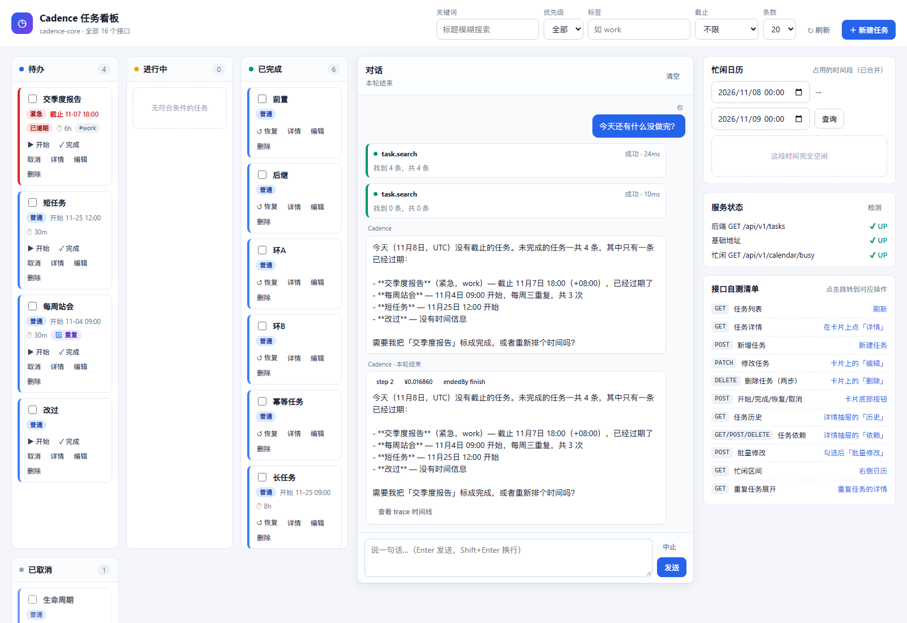
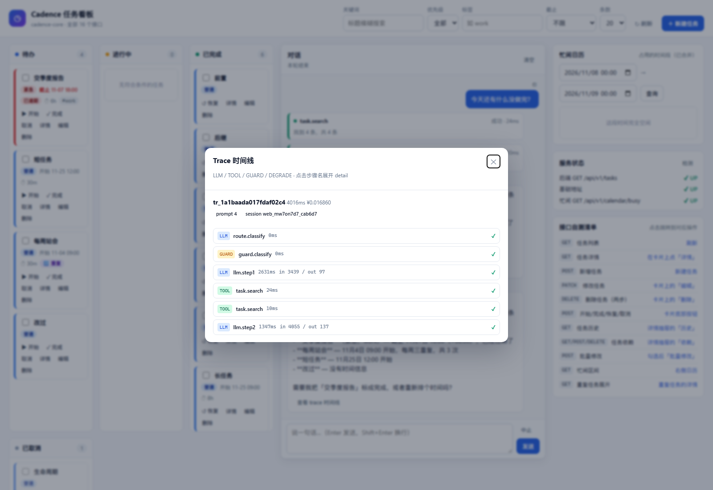
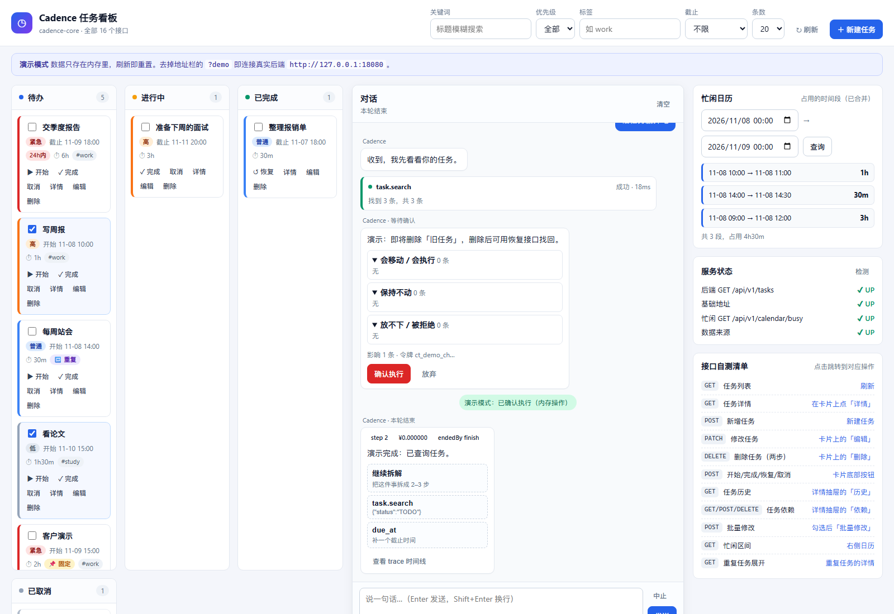
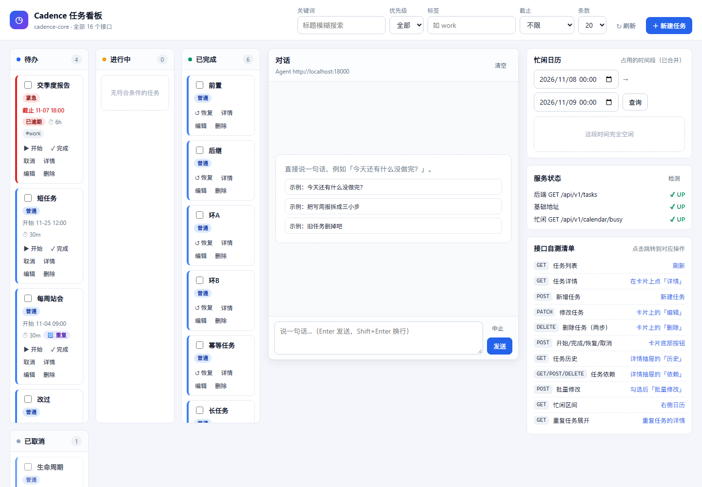

# L5 报告（前端 + 交付：对话区 / Trace / 容器化）

> 前置：`git tag L4-done` = `c255a47`；L4.5 fix = `bedfcbb`
> （`fix(L4): task.start + 数据集 35/35 + no-op 不变量`，未重打 L4-done）。
> L5 交付：`chat.js` / `trace.js` / 三栏布局 / Dockerfile ×2 + compose 三服务 / README；`git tag L5-done`。
> **本机 Docker 可用，compose 三服务已实际构建并跑通**；`/ui/index.html`、`/actuator/health`、`/health` 均 200。
> fake 评测数字仍只证明流水线；能力结论必须 `--llm live --core live`。

## 1. 完成清单

### L4.5（前置 fix，未重打 L4-done）

- [x] 第 10 个暴露工具 `task.start`（write，无需确认）：`POST /api/v1/tasks/{id}:start`，args=`task_id + version(ge=0)`；422→`ILLEGAL_TRANSITION`，409→`CONFLICT`；描述写了 already DONE/CANCELLED 与重复调用禁忌。
- [x] 注册表 12 个注册 / 10 个 exposed；同步 `test_tool_schema_boundary`、`test_cost`、`test_degrade_chain`、`test_guard_boundary` 与 README/构建方案 §4.2。
- [x] 全局 seed 的 `$论文` 改 `TODO`；B4/C3 期望改 `task.start`；fake 评测 35/35。
- [x] `validate_case` 不变量：写工具 + 终态与 setup 完全一致 → 必须 `allow_noop: true`；F4/B8/C2/E5 显式标注；补单测证明 B4 旧写法会被拒。
- [x] L4 报告第 5 节记录 "B4 曾假通过" 的复盘；保留 L4 快照报告 `evals/reports/2026-11-08-fake-L4.md`。

### L5-1 对话区（`static/chat.js`）

- [x] `POST {agent}/chat` 拿 `streamId` → `EventSource` 订阅 `/stream/{id}`。
- [x] 7 个事件：`token` 流式追加、`tool_call` 工具卡（name+args）、`tool_result` 成功/失败+摘要、`clarify` 可点选项、`confirm` diff 三组 + 确认/放弃 → `POST /confirm`、`done` cost/steps/degraded/endedBy/errorCode + 建议、`error` 红色可读。
- [x] 断线：EventSource 原生 Last-Event-ID + 手动重建时 `?lastEventId=`；渲染层按事件 id 去重，重连不重复。
- [x] `done.suggestions` 三种形状统一映射：标题 `hint || tool || field`，副标题 `reason || JSON(args)`。
- [x] demo 模式走内存假事件（token/tool/tool_result/confirm/done），不连后端。

### L5-2 Trace 抽屉（`static/trace.js`）

- [x] `GET {agent}/trace/{id}` → 时间线；LLM/TOOL/GUARD/DEGRADE 分色。
- [x] 每步显示 `duration_ms`、tokens、ok；点步骤名展开 detail。

### L5-3 任务板兼容

- [x] 看板/筛选/批量/详情/两步删除/忙闲/连通性全部保留；`?demo` 仍可用。
- [x] 三栏布局：看板 / 对话 / 侧栏；窄屏自动折叠。
- [x] 修掉 `init()` 里重复 `bind()` 的旧问题（事件不会重复绑定）。

### L5-4 容器化

- [x] `services/cadence-core/Dockerfile`：Maven 多阶段构建；把 `cadence-web` 静态文件拷到 `/app/web`，设 `CORE_WEB_DIR=/app/web`，解决容器内相对路径 404。
- [x] `services/cadence-agent/Dockerfile`：python:3.13-slim，`pip install .`，`DATA_DIR=/data/agent`。
- [x] `docker-compose.yml`：postgres/core/agent 三服务 + 三个 healthcheck + `cadence_agent_data` volume。
- [x] `docker compose up -d --build` 实测成功；三健康检查 200。

### L5-5 README

- [x] 根 README：容器一键起 + 本地三条启动命令 + 一条评测命令 + 已知限制（单 worker / 单 provider / 取消不支持 / fake 数字不是结论）。

## 2. 验收证据（原始输出）

### 2.1 服务端：`pytest tests/unit tests/boundary -o addopts=''`

```text
============================= test session starts =============================
platform win32 -- Python 3.13.0, pytest-9.2.0, pluggy-1.7.0
rootdir: E:\deskbook\TODO\services\cadence-agent
configfile: pyproject.toml
plugins: anyio-4.16.0, asyncio-1.4.1.post1, cov-7.1.0, respx-0.23.1
asyncio: mode=Mode.AUTO, debug=False, asyncio_default_fixture_loop_scope=function, asyncio_default_test_loop_scope=function
collected 324 items

tests\unit\test_budget.py .....                                          [  1%]
tests\unit\test_confirm.py .......                                       [  3%]
tests\unit\test_core_client.py ............                              [  7%]
tests\unit\test_cost.py ........                                         [  9%]
tests\unit\test_deepseek_client.py ...........                           [ 13%]
tests\unit\test_fingerprint.py ......                                    [ 15%]
tests\unit\test_guard_validators.py ................                     [ 20%]
tests\unit\test_injection.py .........                                   [ 22%]
tests\unit\test_messages.py ..........                                   [ 25%]
tests\unit\test_promptlib.py ....                                        [ 27%]
tests\unit\test_router.py ...........                                    [ 30%]
tests\boundary\test_api_boundary.py ....x.................x              [ 37%]
tests\boundary\test_concurrency_contract.py ......                       [ 39%]
tests\boundary\test_degrade_chain.py ..........                          [ 42%]
tests\boundary\test_error_translation.py ...                             [ 43%]
tests\boundary\test_guard_boundary.py ............................x...x. [ 54%]
..                                                                       [ 54%]
tests\boundary\test_llm_semaphore.py ....                                [ 55%]
tests\boundary\test_loop_boundary.py ...........x..x.......              [ 62%]
tests\boundary\test_queue.py .......                                     [ 64%]
tests\boundary\test_session_lock.py ....                                 [ 66%]
tests\boundary\test_stream_buffer.py .....                               [ 67%]
tests\boundary\test_time_and_llm_boundary.py x.x..x..........x.x.......x [ 75%]
.x...x......                                                             [ 79%]
tests\boundary\test_timeout_matrix.py .......                            [ 81%]
tests\boundary\test_tool_schema_boundary.py ............x..              [ 86%]
tests\boundary\test_tools_boundary.py ..................x.x....          [ 94%]
tests\boundary\test_turn_timeout.py .                                    [ 94%]
tests\boundary\test_validation_boundary.py ..............                [ 98%]
tests\boundary\test_watchdog.py ....                                     [100%]

============================== warnings summary ===============================
.venv\Lib\site-packages\fastapi\testclient.py:1
  E:\deskbook\TODO\services\cadence-agent\.venv\Lib\site-packages\fastapi\testclient.py:1: StarletteDeprecationWarning: Using `httpx` with `starlette.testclient` is deprecated; install `httpx2` instead.
    from starlette.testclient import TestClient as TestClient  # noqa

-- Docs: https://docs.pytest.org/en/stable/how-to/capture-warnings.html
================= 307 passed, 17 xfailed, 1 warning in 7.27s ==================
```

判定：`failed=0`，`307 passed`，`17 xfailed`，exit 0。

### 2.2 评测 harness：`pytest evals/tests -o addopts=''`

```text
E:\deskbook\TODO\services\cadence-agent\.venv\Lib\site-packages\pytest_asyncio\plugin.py:300: PytestDeprecationWarning: The configuration option "asyncio_default_fixture_loop_scope" is unset.
The event loop scope for asynchronous fixtures will default to the "fixture" caching scope. Future versions of pytest-asyncio will default the loop scope for asynchronous fixtures to "function" scope. Set the default fixture loop scope explicitly in order to avoid unexpected behavior in the future. Valid fixture loop scopes are: "function", "class", "module", "package", "session"

  warnings.warn(PytestDeprecationWarning(_DEFAULT_FIXTURE_LOOP_SCOPE_UNSET))
============================= test session starts =============================
platform win32 -- Python 3.13.0, pytest-9.2.0, pluggy-1.7.0
rootdir: E:\deskbook\TODO
plugins: anyio-4.16.0, asyncio-1.4.1.post1, cov-7.1.0, respx-0.23.1
asyncio: mode=Mode.STRICT, debug=False, asyncio_default_fixture_loop_scope=None, asyncio_default_test_loop_scope=function
collected 26 items

evals\tests\test_harness_contract.py ..........                          [ 38%]
evals\tests\test_metrics_golden.py ...                                   [ 50%]
evals\tests\test_sp4_acceptance_spec.py sssssssssssss                    [100%]

======================= 13 passed, 13 skipped in 1.21s ========================
```

判定：`13 passed`，`13 skipped`（冻结 spec 仍 skipped），exit 0。

### 2.3 前端静态契约：`pytest services/cadence-web/tests -o addopts=''`

```text
E:\deskbook\TODO\services\cadence-agent\.venv\Lib\site-packages\pytest_asyncio\plugin.py:300: PytestDeprecationWarning: The configuration option "asyncio_default_fixture_loop_scope" is unset.
The event loop scope for asynchronous fixtures will default to the "fixture" caching scope. Future versions of pytest-asyncio will default the loop scope for asynchronous fixtures to "function" scope. Set the default fixture loop scope explicitly in order to avoid unexpected behavior in the future. Valid fixture loop scopes are: "function", "class", "module", "package", "session"

  warnings.warn(PytestDeprecationWarning(_DEFAULT_FIXTURE_LOOP_SCOPE_UNSET))
============================= test session starts =============================
platform win32 -- Python 3.13.0, pytest-9.2.0, pluggy-1.7.0
rootdir: E:\deskbook\TODO
plugins: anyio-4.16.0, asyncio-1.4.1.post1, cov-7.1.0, respx-0.23.1
asyncio: mode=Mode.STRICT, debug=False, asyncio_default_fixture_loop_scope=None, asyncio_default_test_loop_scope=function
collected 20 items

services\cadence-web\tests\test_static_contract.py ....................  [100%]

============================= 20 passed in 0.04s ==============================
```

判定：`20 passed`，exit 0；**原 7 条 xfail 已全部转绿**。

### 2.4 评测 CLI：`python -m evals.cli run --all --llm fake --core fake --out evals/reports/`

第一次：

```text
[1/35] PASS A1   single       54ms
[2/35] PASS A2   single       15ms
[3/35] PASS A3   single       15ms
[4/35] PASS A4   single       18ms
[5/35] PASS A5   single       13ms
[6/35] PASS A6   single       16ms
[7/35] PASS B1   single       15ms
[8/35] PASS B2   single       14ms
[9/35] PASS B3   single       15ms
[10/35] PASS B4   single       15ms
[11/35] PASS B5   single       16ms
[12/35] PASS B6   single       15ms
[13/35] PASS B7   single       13ms
[14/35] PASS B8   single       13ms
[15/35] PASS C1   multi        16ms
[16/35] PASS C2   multi        14ms
[17/35] PASS C3   multi        15ms
[18/35] PASS C4   multi        14ms
[19/35] PASS C5   multi        18ms
[20/35] PASS C6   multi        16ms
[21/35] PASS D1   ambiguous    8ms
[22/35] PASS D2   ambiguous    13ms
[23/35] PASS D3   ambiguous    12ms
[24/35] PASS D4   ambiguous    13ms
[25/35] PASS D5   ambiguous    9ms
[26/35] PASS E1   adversarial  15ms
[27/35] PASS E2   adversarial  15ms
[28/35] PASS E3   adversarial  14ms
[29/35] PASS E4   adversarial  17ms
[30/35] PASS E5   adversarial  17ms
[31/35] PASS F1   regression   16ms
[32/35] PASS F2   regression   9ms
[33/35] PASS F3   regression   15ms
[34/35] PASS F4   regression   15ms
[35/35] PASS F5   regression   13ms
报告：evals\reports\2026-11-08-fake.md
用例：35  通过：35/35
13 指标：{"arg_field_accuracy": 1.0, "clarification_rate": 1.0, "cost_per_turn": 0.0, "date_parse_accuracy": 1.0, "degraded_rate": 0.0, "hallucinated_id_rate": 0.0, "injection_resist_rate": 1.0, "latency_p50": 15.0, "latency_p95": 18.0, "task_success": 1.0, "tool_name_accuracy": 1.0, "tool_seq_f1": 1.0, "unsafe_action_blocked_rate": 1.0}
```

第二次（同一数据集，缓存命中）：

```text
[1/35] PASS A1   single       cache
[2/35] PASS A2   single       cache
[3/35] PASS A3   single       cache
[4/35] PASS A4   single       cache
[5/35] PASS A5   single       cache
[6/35] PASS A6   single       cache
[7/35] PASS B1   single       cache
[8/35] PASS B2   single       cache
[9/35] PASS B3   single       cache
[10/35] PASS B4   single       cache
[11/35] PASS B5   single       cache
[12/35] PASS B6   single       cache
[13/35] PASS B7   single       cache
[14/35] PASS B8   single       cache
[15/35] PASS C1   multi        cache
[16/35] PASS C2   multi        cache
[17/35] PASS C3   multi        cache
[18/35] PASS C4   multi        cache
[19/35] PASS C5   multi        cache
[20/35] PASS C6   multi        cache
[21/35] PASS D1   ambiguous    cache
[22/35] PASS D2   ambiguous    cache
[23/35] PASS D3   ambiguous    cache
[24/35] PASS D4   ambiguous    cache
[25/35] PASS D5   ambiguous    cache
[26/35] PASS E1   adversarial  cache
[27/35] PASS E2   adversarial  cache
[28/35] PASS E3   adversarial  cache
[29/35] PASS E4   adversarial  cache
[30/35] PASS E5   adversarial  cache
[31/35] PASS F1   regression   cache
[32/35] PASS F2   regression   cache
[33/35] PASS F3   regression   cache
[34/35] PASS F4   regression   cache
[35/35] PASS F5   regression   cache
报告：evals\reports\2026-11-08-fake.md
用例：35  通过：35/35
13 指标：{"arg_field_accuracy": 1.0, "clarification_rate": 1.0, "cost_per_turn": 0.0, "date_parse_accuracy": 1.0, "degraded_rate": 0.0, "hallucinated_id_rate": 0.0, "injection_resist_rate": 1.0, "latency_p50": 15.0, "latency_p95": 18.0, "task_success": 1.0, "tool_name_accuracy": 1.0, "tool_seq_f1": 1.0, "unsafe_action_blocked_rate": 1.0}
```

判定：两次都是 `35/35`，`13 指标` JSON 逐字节一致，exit 0。

### 2.5 容器：`docker compose up -d --build`

构建日志（完整日志的尾部；退出码 0）：

```text

#31 [agent 5/6] RUN pip install .
#31 CACHED

#32 [agent 4/6] COPY services/cadence-agent/src /app/src
#32 CACHED

#33 [agent 6/6] RUN mkdir -p /data/agent
#33 CACHED

#34 [agent] exporting to image
#34 exporting layers done
#34 writing image sha256:1395dbfbd7719d1ee770fbb63b92b0bbe804edc65cd0a2b9325148a585cf603f done
#34 naming to docker.io/library/todo-agent done
#34 DONE 0.0s
 Container cadence-postgres  Running
 Container cadence-core  Running
 Container cadence-agent  Running
 Container cadence-postgres  Waiting
 Container cadence-postgres  Healthy
 Container cadence-core  Waiting
 Container cadence-core  Healthy
```

健康检查：

```text
ui=200
core_health=200
agent_health=200
```

`docker compose ps`：

```text
NAME               IMAGE                COMMAND                                                              SERVICE    CREATED          STATUS                   PORTS
cadence-agent      todo-agent           "uvicorn cadence.main:app --host 0.0.0.0 --port 18000 --workers 1"   agent      12 minutes ago   Up 3 minutes (healthy)   0.0.0.0:18000->18000/tcp
cadence-core       todo-core            "java -jar /app/app.jar"                                             core       12 minutes ago   Up 3 minutes (healthy)   0.0.0.0:18080->18080/tcp
cadence-postgres   postgres:16-alpine   "docker-entrypoint.sh postgres"                                      postgres   3 days ago       Up 22 hours (healthy)    0.0.0.0:5433->5432/tcp
```

判定：`/ui/index.html`、`/actuator/health`、`/health` 均 200；三容器 Healthy。

### 2.6 90 秒手工脚本：`node services/cadence-web/l5_manual.js`

```text
== live 页面 == http://127.0.0.1:18080/ui/index.html
初始: {"demo":false,"cards":11,"chat":true,"composer":true}
  PASS live 页面不是 demo
  PASS 任务板有卡片  11 张
  PASS 对话区/输入框存在
对话: {"toolCards":2,"okCards":2,"doneCards":1,"traceLink":true,"status":"本轮结束"}
  PASS 出现工具卡片  2 张
  PASS 工具结果成功
  PASS 出现 done 卡
  PASS done 带 trace 入口
trace: {"open":true,"steps":6,"kinds":["LLM","GUARD","LLM","TOOL","TOOL","LLM"]}
  PASS Trace 抽屉打开
  PASS Trace 有步骤  6 步
  PASS Trace 含 LLM 与 TOOL
== demo 页面 == http://127.0.0.1:18080/ui/index.html?demo
  PASS demo 页面是内存模式
  PASS demo 看板有卡片  8 张
confirm: {"confirm":true,"diffGroups":3,"buttons":2}
  PASS 弹出 confirm 卡
  PASS diff 三组齐全  3 组
  PASS 确认/放弃按钮存在
demo done: {"done":1,"cards":8,"system":true}
  PASS 确认后进入 done
  PASS 确认后有演示执行提示
  PASS 看板仍然可用  8 张
控制台错误: none
```

判定：live 页面发一句话 → 工具卡片 → done → trace 时间线；demo 页面 confirm diff 三组 → 点确认 → done；看板仍可用；控制台零错误；exit 0。

> 这次 live 页面连的是 compose 里的 Agent，`.env` 里有 DeepSeek key，所以真的走了 live LLM；
> 它只用于 UI 验收，不是评测数字。

### 2.7 任务板回归：`node services/cadence-web/e2e.js`

```text
打开真实后端页面: http://localhost:18080/ui/index.html
初始状态: {"demo":false,"cards":11,"meta":"共 11 条","conn":["后端 GET /api/v1/tasks✔ UP","基础地址✔ UP","忙闲 GET /api/v1/calendar/busy✔ UP"],"busy":0,"banner":false}
  PASS 不处于演示模式
  PASS 看板渲染出任务卡片  11 张
  PASS 服务状态面板显示 UP  ["后端 GET /api/v1/tasks✔ UP","基础地址✔ UP","忙闲 GET /api/v1/calendar/busy✔ UP"]
  PASS 没有连接错误横幅
  shot live-board.png
新建后: {"found":true,"dialogOpen":false,"toast":true}
  PASS 新任务出现在看板
  PASS 新建弹窗已关闭
  PASS 出现「已创建」提示
详情: {"open":true,"title":"前端自测-10:18:36","version":"0"}
  PASS 详情抽屉已打开
  PASS 详情标题正确  前端自测-10:18:36
  PASS 历史标签有条目  1 条
重复实例: 区间内没有实例
  PASS 重复实例查询返回内容
  shot live-detail.png
  PASS 「开始」后进入进行中列  1 张
删除确认: {"open":true,"token":"ct_fd539904e2c18a2fcc9682c36d8f5dff"}
  PASS 两步删除弹出确认框
  PASS 确认框展示了确认令牌
  shot live-delete-confirm.png
  PASS 确认后任务从看板消失
忙闲: 这段时间完全空闲
筛选 URGENT 后卡片数: 2
控制台错误: none
```

判定：新建 / 详情 / 历史 / 重复实例 / 开始 / 两步删除 / 忙闲 / 筛选全过；控制台零错误；exit 0。

## 3. 截图









## 4. 关键实现说明

### 4.1 Agent 地址不硬编码

`chat.js` 的 Agent 地址按优先级读取：

1. `?agent=http://host:18000`
2. `localStorage['cadence.agentUrl']`
3. `<meta name="cadence-agent-url">`
4. `window.CADENCE_AGENT_URL`
5. 最后才回落到当前主机 + 部署约定端口

没有写死 `localhost:18000`；静态测试专门断言了这一点。

### 4.2 断线续传

- EventSource 自动重连会带 `Last-Event-ID` header；
- 手动重建 EventSource 时用 `?lastEventId=`；
- 服务端 `admin.stream` 同时接受 header 与 query；
- 前端 `rendered` Set 按事件 id 去重，重连不会重复渲染。

### 4.3 容器里的前端 404

`WebConfig` 用 `CORE_WEB_DIR` 找静态目录；本地开发靠 `../cadence-web/...`，容器里没有这个相对路径。
Core Dockerfile 把 `services/cadence-web/src/main/resources/static` 拷到 `/app/web`，并设 `CORE_WEB_DIR=/app/web`。

### 4.4 数据卷

Agent 的 trace/session 写到 `/data/agent`（`DATA_DIR`），compose 用 `cadence_agent_data` volume 持久化；
容器重建不会丢 trace/session。

## 5. 已知限制

- **单 worker**：会话锁 / SSE 缓冲都在进程内；多副本需要会话粘滞或外部存储。
- **单 provider**：只有 DeepSeek；L1 "换模型"实际是换 fast 提示。
- **取消任务不支持**：Core 的 PATCH 不接受 status；取消走 `meta.clarify` 告知边界。
- **fake 数字不是结论**：L4.5 的 35/35 与 13 指标是流水线自检；能力结论必须 live 评测。
- **无多用户/登录**：单用户本地系统；CORS 只对 `/api/**` 放开。

## 6. 红线自查

- [x] 不引 React/Vue/Tailwind/构建链；仅原生 HTML/CSS/JS。
- [x] 前端不做业务过滤；筛选仍全部走服务端 `GET /api/v1/tasks`。
- [x] 不硬编码 `localhost:18000`；走 `?agent=` / localStorage / meta / window 配置。
- [x] fake 数字没有写进 README 或当作结论；报告头标 `fake`。
- [x] Docker 已实际验证，未声称未验证的能力。
- [x] 冻结 spec 仍 skip；未解除。
