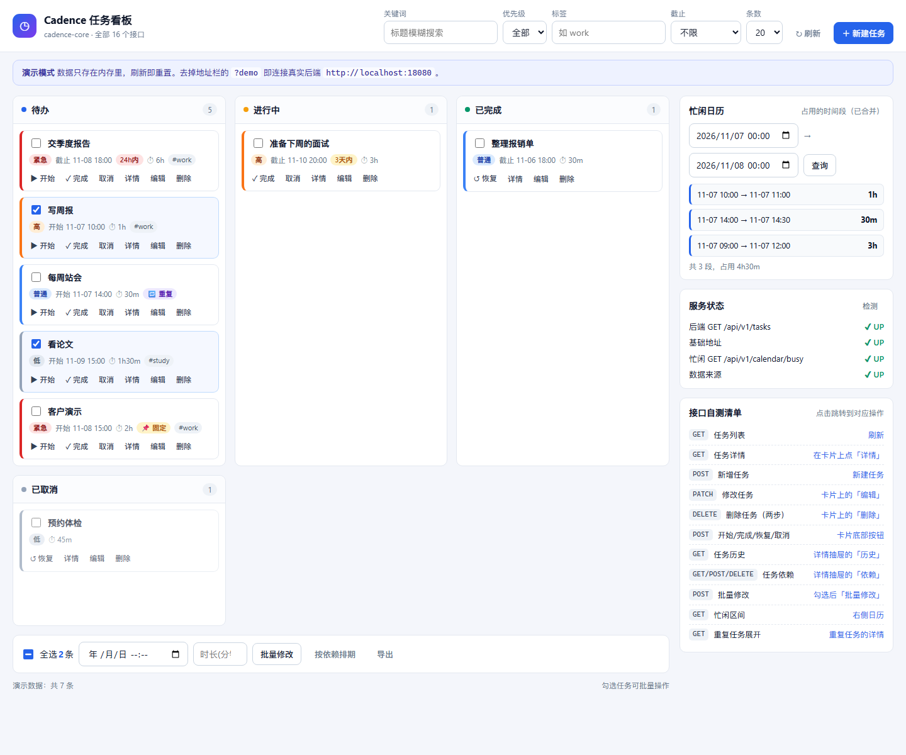
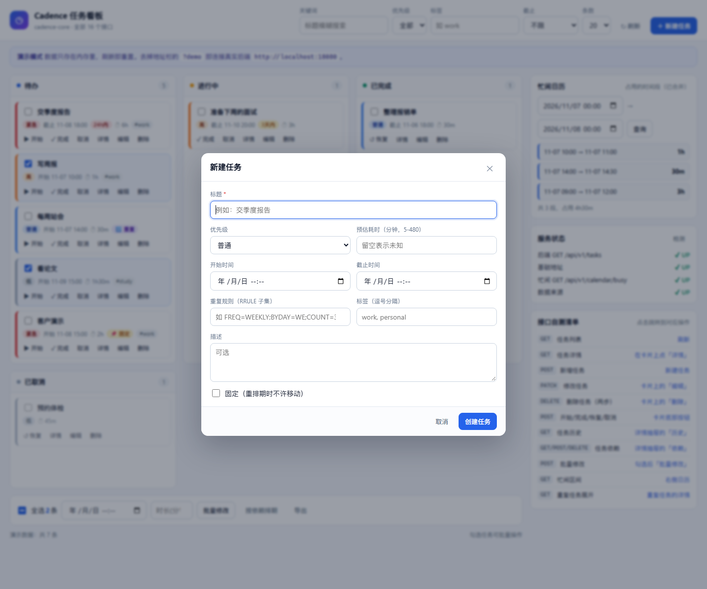
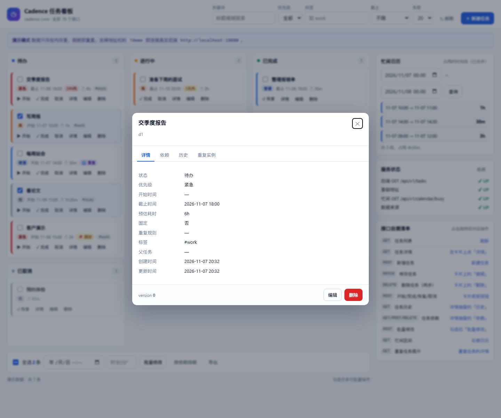
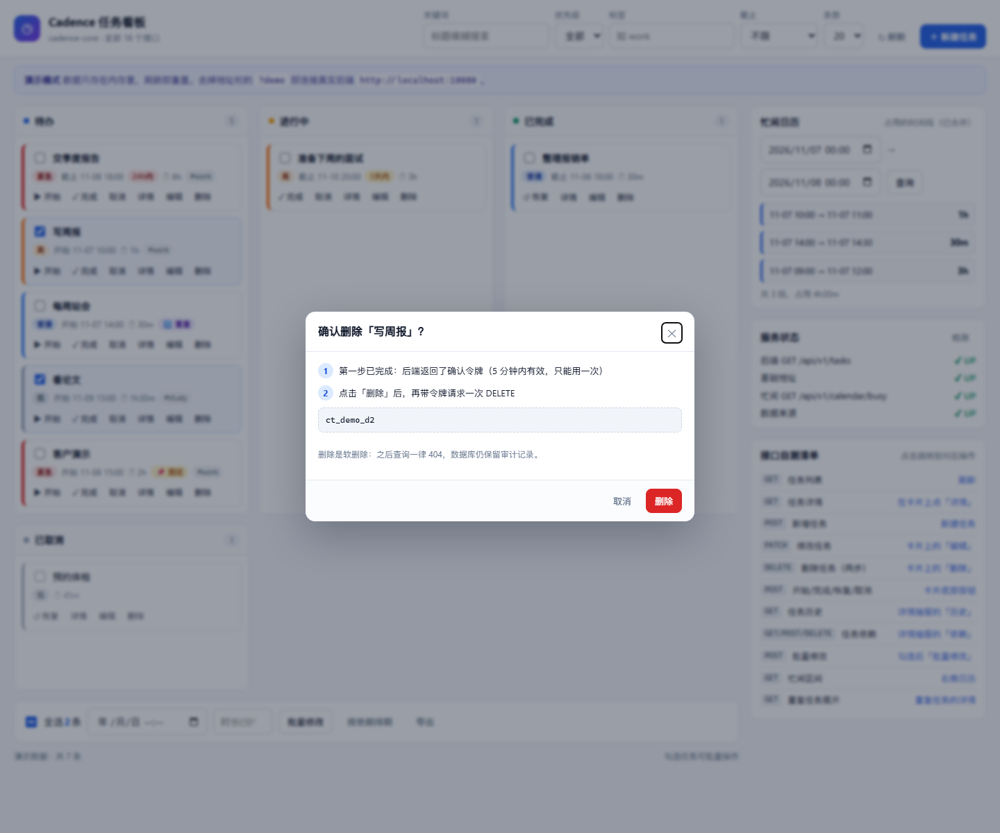

# cadence-web · 前端页面

> 原生 HTML + CSS + JS，**无构建、零外部依赖**。由 `cadence-core` 直接托管在 `/ui/`。
> 严格按 [`docs/接口文档.md`](../../docs/接口文档.md) v0.2.0 实现，覆盖 cadence-core **全部 16 个已实现接口**。



---

## 一、30 秒看到页面

```powershell
# 1. 数据库（仓库根目录）
docker compose up -d postgres

# 2. 后端（同时托管前端）
cd services/cadence-core
mvn spring-boot:run

# 3. 打开浏览器（会 302 到 /ui/index.html）
Start-Process http://localhost:18080
```

**后端没起也想看界面？** 直接在地址栏加 `?demo`：

```
http://localhost:18080/ui/index.html?demo
```

演示模式用内存数据把每个按钮都点得通（刷新即重置），页面上方会有蓝色提示条。

**单独起静态服务器也行**（后端 `/api/**` 已放开 CORS）：

```powershell
cd services/cadence-web/src/main/resources/static
python -m http.server 5500
# 打开 http://localhost:5500/?api=http://localhost:18080
```

---

## 二、页面长什么样

```
┌──────────────── 顶栏：关键词 / 优先级 / 标签 / 截止 / 条数 / 刷新 / 新建任务 ────────────────┐
├──────────────────────────────────────────────┬──────────────────────────────────────────────┤
│  看板：待办 │ 进行中 │ 已完成                     │  忙闲日历：选时间段 → 占用的时段（已合并）      │
│  卡片：勾选 · 优先级色条 · 截止紧急度 · 时长    │  服务状态：三条连通性探测 + 耗时                │
│        重复/固定标记 · 标签                   │  接口自测清单：11 项，点右侧文字直接跳到对应操作 │
│  卡片操作：开始 / 完成 / 取消 / 恢复 /        │                                              │
│            详情 / 编辑 / 删除                 │                                              │
├──────────────────────────────────────────────┤                                              │
│  勾选后出现：全选 · 批量修改 · 按依赖排期 · 导出 │                                              │
│  底部：已取消列 + 统计                          │                                              │
└──────────────────────────────────────────────┴──────────────────────────────────────────────┘
```

| 新建 / 编辑 | 详情抽屉 | 两步删除确认 |
|---|---|---|
|  |  |  |

---

## 三、功能 ↔ 接口对照

| 页面功能 | 调用的接口 | 实现要点 |
|---|---|---|
| 看板三列 + 筛选 | `GET /api/v1/tasks` | 关键词/优先级/标签/截止/条数**全部走服务端过滤**，不在前端过滤 |
| 「已取消」列 | `GET /api/v1/tasks?status=CANCELLED` | 单独查一次 |
| 双击卡片 / 「详情」 | `GET /api/v1/tasks/{id}` | 展示前置、后继、时间冲突 |
| 「新建任务」 | `POST /api/v1/tasks` | 自动带 `X-Idempotency-Key`，双击不会建两条 |
| 「编辑」 | `PATCH /api/v1/tasks/{id}` | 带 `version`；返回的 `warnings[]` 用黄色 toast 提示，不当作失败 |
| 「删除」 | `DELETE` 两次 | 第一次 403 → 弹窗展示 `data.confirmToken` → 确认后带 `X-Confirm-Token` → 204 |
| 开始 / 完成 / 恢复 / 取消 | `POST /api/v1/tasks/{id}:start` 等 | 按钮按状态自动出现；后端 422 的原因原样提示 |
| 「历史」标签 | `GET .../history` | 时间线，可展开 `before`/`after` 快照 |
| 「依赖」标签 | `GET/POST/DELETE .../dependencies` | 成环时显示后端 422 的说明 |
| 批量修改 / 按依赖排期 | `POST /api/v1/tasks:batch` | 一条 op 对应一个任务；「按依赖排期」先弹预览再执行 |
| 忙闲日历 | `GET /api/v1/calendar/busy` | 时间区间里的 `+` 由 `URLSearchParams` 自动编码成 `%2B` |
| 「重复实例」标签 | `GET .../occurrences` | 把 `rrule` 展开成具体时间点 |
| 服务状态面板 | 上面几个接口各打一次 | 显示 UP/DOWN 与耗时，帮你在联调时一眼看出是哪条线断了 |

---

## 四、几个刻意的设计

1. **错误不留给人看英文。** `api.js` 把 `{code,message,data}` 统一解包；失败一律抛出 `ApiError`（带 `status`/`code`/`message`），
   页面用 toast 展示 `message` + `HTTP xx · code xx`。连不上后端时，顶部横幅直接告诉你去跑哪条命令。

2. **`version` 冲突（409）不吓唬用户。** 卡片上的操作遇到 409 会提示「任务刚被别人改过，已为你刷新」并自动重拉，
   而不是让人面对一个红色报错。

3. **两步删除如实展示。** 弹窗里写明「第一步已拿到令牌 / 第二步带令牌再删」，令牌也显示出来——
   这是后端 FR-4 的设计，前端不藏起来。

4. **弹窗用 `showModal()`，但要绕一个浏览器行为。** 同一个 task 里第一个 Promise 微任务执行时，
   刚 `showModal()` 打开的模态层会被同步移除。所以所有弹窗统一走 `openModal()`：推到下一个宏任务打开，
   并保证同一时刻只有一个模态弹窗。

5. **演示模式与真实接口同一套页面逻辑。** `api.js` 里有一个调度器，`?demo` 时走内存实现，否则走 fetch；
   页面代码只认 `cadence.*`，两种模式行为一致。

---

## 五、文件

| 文件 | 作用 |
|---|---|
| `src/main/resources/static/index.html` | 页面结构（顶栏、看板、侧栏、三个弹窗） |
| `src/main/resources/static/app.css` | 全部样式，无外部字体/CDN |
| `src/main/resources/static/api.js` | 接口封装：统一解包、错误映射、幂等键、时间格式转换、演示数据 |
| `src/main/resources/static/app.js` | 页面逻辑：看板、表单、状态流转、两步删除、详情抽屉、批量、忙闲、连通性 |
| `shots.js` | 截图脚本（Node 18+，零依赖，走 CDP）：`node shots.js` |
| `e2e.js` | 联真实后端的页面级自测：`node e2e.js`（会建一条任务再删掉） |
| `docs/*.png` | 演示模式与真实后端的截图 |

改完保存、刷新浏览器即可，没有构建步骤。

---

## 六、快捷键

| 键 | 作用 |
|---|---|
| `n` | 新建任务 |
| `/` | 聚焦搜索框 |
| `Esc` | 关闭弹窗 |
| 双击卡片 | 打开详情抽屉 |
